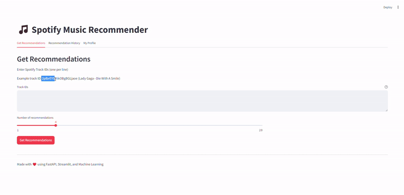

# Spotify Music Recommendation System 🎵

A music recommendation web app built with **FastAPI, Streamlit, and the Spotify Web API**. Enter a Spotify track ID to discover songs, explore recommendations, and rate tracks to record your preferences.

## Demo



## Features

- User registration and login
- Music recommendations based on a seed track
- Track details and popularity display
- User ratings and preference tracking
- Interactive Streamlit interface
- FastAPI backend with API documentation

## Tech Stack

- **Backend:** FastAPI, SQLAlchemy, Pydantic
- **Frontend:** Streamlit
- **Database:** SQLite
- **Authentication:** JWT
- **Music Data:** Spotify Web API
- **Data & ML:** Pandas, NumPy, Scikit-learn, TensorFlow, XGBoost
- **Visualization:** Plotly

## Getting Started

### 1. Clone the repository

```bash
git clone https://github.com/YOUR_USERNAME/spotify-music-recommendation-system.git
cd spotify-music-recommendation-system
```

Replace `YOUR_USERNAME` with your GitHub username.

### 2. Create a virtual environment

```bash
python -m venv .venv
```

Activate it on Windows:

```powershell
.\.venv\Scripts\Activate.ps1
```

### 3. Install dependencies

Install the required packages used by the project:

```bash
pip install fastapi uvicorn streamlit sqlalchemy pydantic-settings python-dotenv "python-jose[cryptography]" "passlib[bcrypt]" "bcrypt==4.0.1" spotipy pandas numpy plotly scikit-learn xgboost tensorflow
```

### 4. Configure environment variables

Create a `.env` file in the project root:

```env
SPOTIFY_CLIENT_ID=your_spotify_client_id
SPOTIFY_CLIENT_SECRET=your_spotify_client_secret
DATABASE_URL=sqlite:///./spotify_recommender.db
SECRET_KEY=your_random_secret_key
```

Get your Spotify API credentials from the [Spotify Developer Dashboard](https://developer.spotify.com/dashboard/).

**Keep your `.env` file and API credentials private. Never commit secrets to GitHub.**

### 5. Run the application

Start the FastAPI backend from the project root:

```bash
uvicorn main:app --reload
```

Open a second terminal in the same project directory, activate the virtual environment, and start Streamlit:

```powershell
.\.venv\Scripts\Activate.ps1
streamlit run streamlit_app.py
```

### 6. Open the app

- **Web app:** http://localhost:8501
- **API documentation:** http://localhost:8000/docs

## How to Use

1. Register an account and log in.
2. Enter a Spotify track ID.
3. Generate and explore the recommended songs.
4. Rate tracks to save your preferences.

To find a track ID, open a song on Spotify and copy its link. The ID is the part after `/track/` in the URL.

## Project Structure

```text
spotify-music-recommendation-system/
├── demo/
├── docs/
├── models/
├── models_store/
├── routers/
├── services/
├── config.py
├── database.py
├── main.py
├── streamlit_app.py
└── README.md
```

## License

This project is distributed under the [MIT License](LICENSE), if the included license file applies.

## Acknowledgments

- [Spotify Web API](https://developer.spotify.com/documentation/web-api/)
- [FastAPI](https://fastapi.tiangolo.com/)
- [Streamlit](https://streamlit.io/)